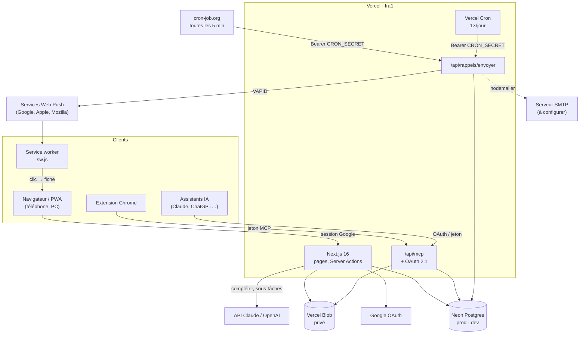

# Architecture

[← Retour au README](../README.md)

## Stack

| Couche | Choix |
|---|---|
| Application | Next.js 16 (App Router, Server Components, Server Actions), TypeScript, Tailwind CSS 4 |
| Base | PostgreSQL : Neon en dev et en prod, Postgres local ou PGlite en test |
| Accès aux données | Drizzle ORM ; migrations SQL versionnées dans `drizzle/` |
| Authentification | Auth.js v5 (Google, plus une connexion de test hors prod) |
| Fichiers | Vercel Blob en mode **privé** ; dossier `.uploads/` en local |
| Aperçus de documents | pdf.js, mammoth, read-excel-file, JSZip, chargés à la demande côté navigateur |
| Hébergement | Vercel (région `fra1`), domaines chez Hostinger |
| Rappels | notifications Web Push (`web-push`, clés VAPID, service worker `public/sw.js`), e-mail SMTP (`nodemailer`) ; route d'envoi appelée toutes les 5 minutes par cron-job.org, et une fois par jour par Vercel Cron |

## Vue d'ensemble



## Organisation du code

```
src/
  app/
    (app)/                 pages protégées (layout = session obligatoire)
      page.tsx             arbre
      objets/              fiche, création, modification
      taches/              liste, fiche, création
      documents/[id]/      visionneuse
      types/               gestion des types
      journal/             journal des actions
      rappels/             mes rappels : canaux, appareils, essai
      assistant/           chat avec Claude / ChatGPT utilisant les outils MCP
      utilisateurs/        accès, assistants IA, schémas de rappel (admin)
    connexion/             page de connexion
    actions.ts             Server Actions (contrôle de session + validation)
    reminder-actions.ts    Server Actions des rappels (préférences, schémas, essai)
    api/
      auth/                Auth.js
      photos/              lecture, autorisation d'envoi, envoi local
      documents/           lecture, autorisation d'envoi
      test/purge/          purge des données de test (hors prod)
      mcp/                 serveur MCP (lecture, écriture, suppression selon les droits ; voir docs/mcp.md)
      oauth/               OAuth 2.1 : register, token, revoke
      assistant/           réponse du chat en flux NDJSON (session obligatoire)
      rappels/envoyer/     envoi des rappels (Bearer CRON_SECRET, idempotent)
      rappels/abonnement/  abonnement Web Push de l'appareil courant
    .well-known/           métadonnées OAuth (RFC 9728, RFC 8414)
    oauth/autoriser/       page de consentement OAuth
  components/              composants d'interface (client ou serveur)
  db/schema.ts             schéma Drizzle
  lib/
    repo.ts                requêtes (chaque fonction reçoit la base : testable sur PGlite)
    tree.ts                logique d'arbre pure (forêt, cumuls, chemins, récurrence)
    audit.ts               journal des actions (auteur, origine, différences, libellés)
    storage.ts             Blob / local, chemins, suppression
    document-types.ts      formats acceptés, visionneuses
    chat.ts                chat : boucle modèle ↔ outils MCP (serveur MCP en mémoire)
    dependencies.ts        enchaînement des tâches : attend / débloque, anti-boucle, tâches prêtes
    gantt.ts               calcul pur du Gantt (échelle, barres, flèches, conflits) et de l'avancement
    notify-ready.ts        notification « Prête » quand une tâche attendue est faite
    reminders.ts           calcul pur des rappels (J/H/M, heure de Paris, rattrapage)
    reminder-repo.ts       schémas, appareils, préférences, boucle d'envoi
    notify.ts              expéditeurs : Web Push (VAPID) et SMTP
    session.ts, forms.ts, seed.ts…
public/sw.js               service worker : affiche les notifications, ouvre la tâche au clic
vercel.json                cron Vercel quotidien des rappels
scripts/migrate.ts         migrations + arbre de départ (lancé au build)
drizzle/                   migrations SQL et instantanés
tests/                     tests unitaires (Vitest + PGlite)
e2e/                       tests de bout en bout (Playwright)
docs/                      cette documentation
```

## Modèle de données

```
users ──< todos (assignee_id, created_by_id)
  │  ├──< push_subscriptions            appareils abonnés aux notifications
  │  ├──< api_tokens >── oauth_clients ──< oauth_codes
  │  └──  notify_email, notify_push      canaux de rappel choisis
  │
object_types ──< objects ──< objects (parent_id, arbre)
                    │  ├──< todos ──< subtasks
                    │  │     ├──< photos (todo_id)
                    │  │     ├──< reminder_deliveries      rappels déjà traités
                    │  │     ├──> reminder_schemes         J-10 / J-1 / H-3 / M-10…
                    │  │     ├──< todo_dependencies >── todos   (« attend », fin → début)
                    │  │     ├──> task_types
                    │  │     └──> todos (previous_occurrence_id, récurrence)
                    │  ├──< photos (object_id)
                    │  ├──< documents >── document_types   (documents et liens :
                    │  └──< links                          objet OU tâche)

audit_log      journal (sans clé étrangère vers l'élément : survit à la suppression)
commands       commandes de saisie $$nom / @@nom
app_settings   réglages (clés d'API IA chiffrées)
```

| Table | Points clés |
|---|---|
| `objects` | `parent_id` auto-référencé (`RESTRICT`), contrainte « pas son propre parent », `type_id` → `object_types` (`RESTRICT`), `position` pour l'ordre |
| `todos` | `object_id` (`RESTRICT`), valeurs numériques estimées/réalisées, enums priorité/statut/catégorie/récurrence, `previous_occurrence_id` unique (une seule occurrence suivante), `due_date` + `due_time` facultative (contrainte : pas d'heure sans date), `reminder_scheme_id` (`SET NULL`) |
| `photos` | rattachée à un objet **ou** à une tâche (contrainte), `is_cover`, chemins de la photo et de la vignette, `description` (légende) |
| `documents` | rattaché à un objet **ou** à une tâche (contrainte `documents_one_owner`), `type_id` → `document_types` (`RESTRICT`), nom d'origine, type MIME, taille, chemin (`<env>/documents/<objet>/…` ou `<env>/documents/taches/<tâche>/…`) |
| `links` | rattaché à un objet **ou** à une tâche (contrainte `links_one_owner`), URL http(s) normalisée, titre facultatif |
| `object_types`, `document_types` | `name` unique sans tenir compte de la casse (index sur `lower(name)`) |
| `chat_attachments` | pièces jointes du chat de l'assistant (7 jours, propriétaire seul) |
| `todo_dependencies` | enchaînement des tâches (`todo_id` attend `depends_on_id`), sans boucle (voir [gestion-de-projet.md](gestion-de-projet.md)) |
| `reminder_schemes`, `push_subscriptions`, `reminder_deliveries` | rappels : schémas, appareils abonnés aux notifications, rappels déjà traités (voir [rappels.md](rappels.md)) |
| `audit_log` | journal des actions sur les objets et les tâches : origine (`interface`, `api`, `mcp`, `systeme`), application, auteur, élément (sans clé étrangère : survit à la suppression), objet concerné, action, détails JSON (voir [journal.md](journal.md)) |
| `users` | e-mail unique, rôle, actif, heures/semaine, compétences |
| `oauth_clients`, `oauth_codes`, `api_tokens` | accès des assistants IA (MCP) : clients OAuth, codes d'autorisation, jetons personnels / d'accès / de rafraîchissement (empreintes SHA-256 seulement) |

### Règles garanties côté serveur

- **Déplacement** : `LOCK TABLE objects` puis requête récursive qui refuse la destination si elle appartient au sous-arbre déplacé.
- **Suppression d'objet** : refusée s'il reste des sous-objets ou des tâches. Les photos, documents et liens partent en cascade, et les fichiers sont effacés ensuite.
- **Types** : suppression refusée s'ils sont utilisés (message clair, plus la clé étrangère `RESTRICT`).
- **Cumuls** : calculés à partir des statistiques par objet, remontées dans l'arbre (`lib/tree.ts`).

## Sécurité

- Chaque page de `(app)` et chaque Server Action appelle `requireUser()` (ou `requireAdmin()`), qui relit l'utilisateur en base à chaque requête.
- Fichiers privés : lecture uniquement via `/api/photos/[id]` et `/api/documents/[id]`, après contrôle de session.
- Envois directs vers Blob : le serveur n'émet un jeton que pour un chemin valide (`<env>/objets|taches|documents/<id>/…`), un type autorisé et une taille limitée.
- Documents servis avec `nosniff` et `CSP: sandbox`. Le HTML issu d'un `.docx` est nettoyé avant affichage.
- Liens : uniquement des URL http et https.
- Connexion de test : comparaison à temps constant, désactivée en production.

## Fichiers et environnements

Les chemins de stockage commencent par l'environnement Vercel (`production/…`, `preview/…`, `local/…`), ce qui permet au dev et à la prod de partager le même store sans se mélanger.
